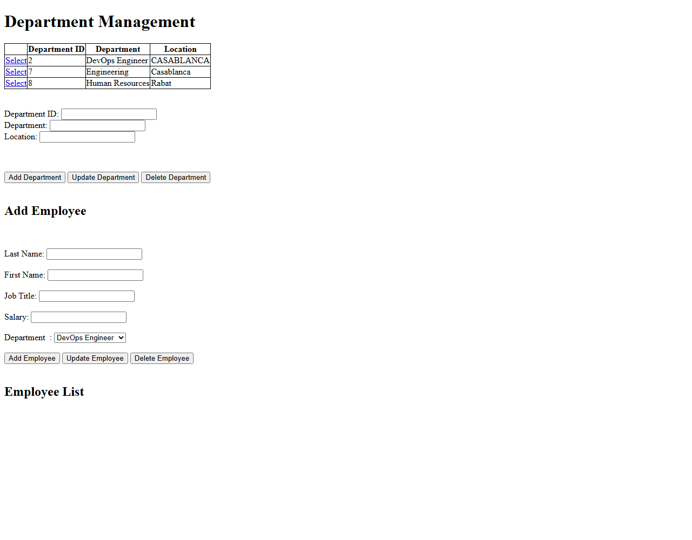
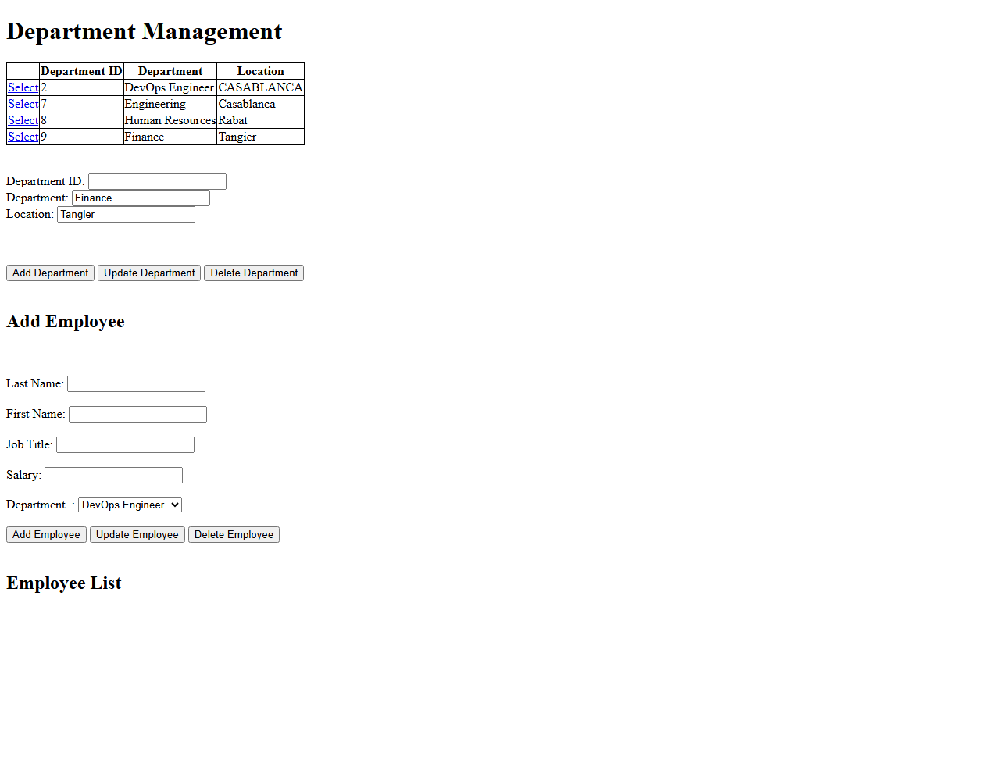
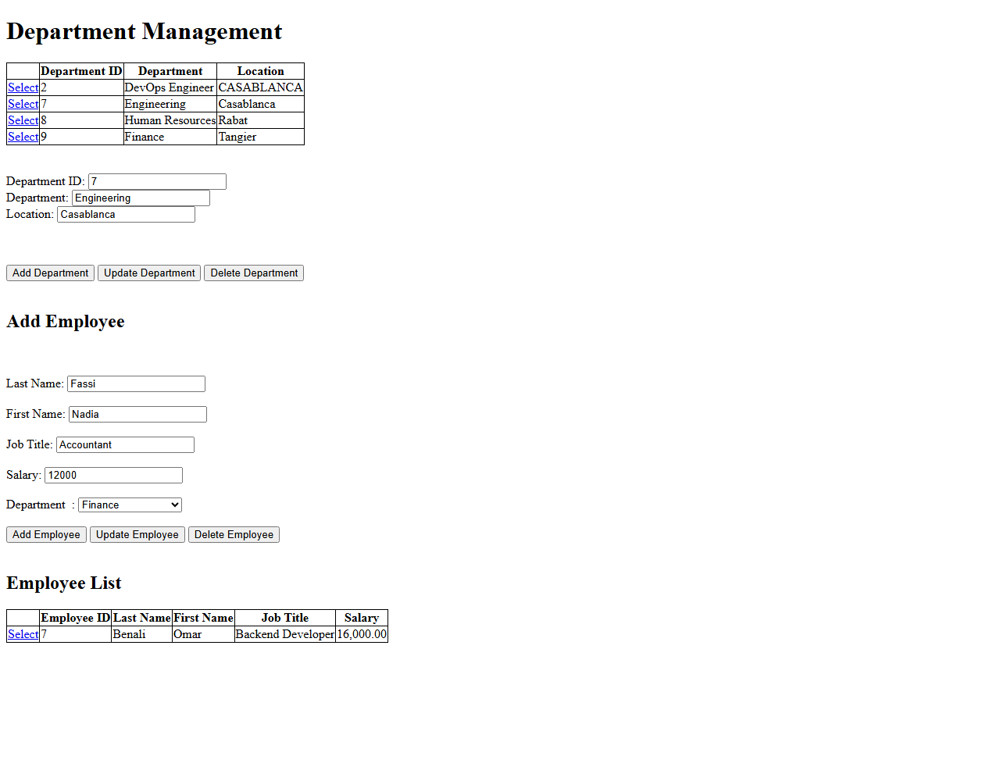
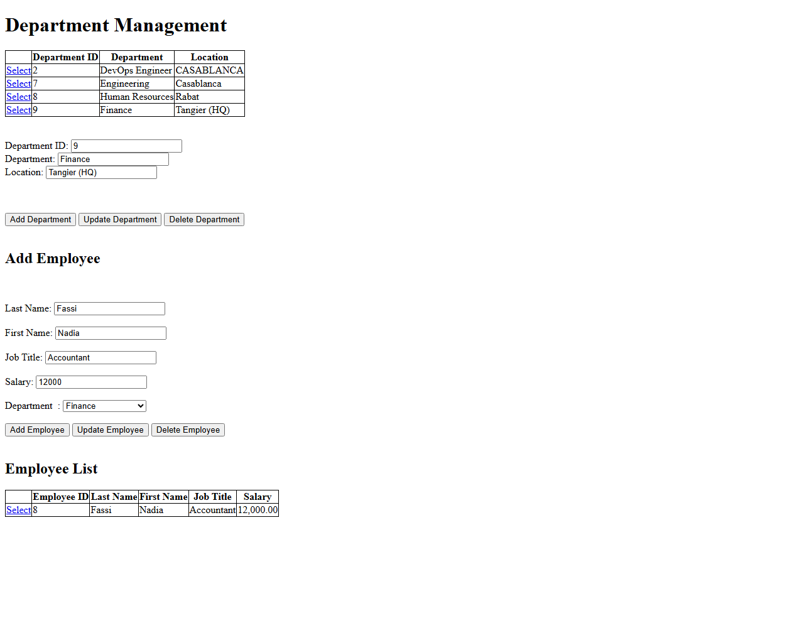
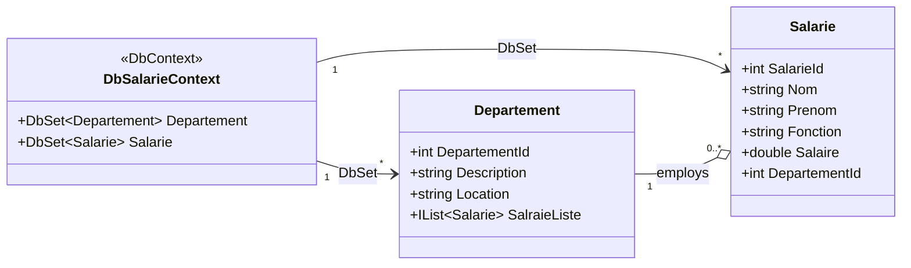

<div align="center">

# 🏢 ASP.NET HR Management System

### A clean, Code-First HR web app for managing departments & employees

[](https://dotnet.microsoft.com/)
[](https://learn.microsoft.com/dotnet/csharp/)
[](https://learn.microsoft.com/ef/ef6/)
[](https://learn.microsoft.com/sql/database-engine/configure-windows/sql-server-express-localdb)
[](https://visualstudio.microsoft.com/insiders/)
[](#)
[](#-license)

<br/>


&nbsp;&nbsp;

&nbsp;&nbsp;


</div>

---

## 📑 Table of Contents

- [📖 Overview](#-overview)
- [✨ Features](#-features)
- [🎥 Demo](#-demo)
- [🧱 Tech Stack](#-tech-stack)
- [🗺️ Domain Model](#️-domain-model)
- [📂 Project Structure](#-project-structure)
- [🚀 Getting Started](#-getting-started)
- [🛠️ Build It From Scratch in Visual Studio Enterprise 2026 Insiders](#️-build-it-from-scratch-in-visual-studio-enterprise-2026-insiders)
- [📚 Learn & Build Your Own Exercise](#-learn--build-your-own-exercise)
- [🗄️ Database Notes](#️-database-notes)
- [🧭 Roadmap](#-roadmap)
- [🤝 Contributing](#-contributing)
- [📄 License](#-license)
- [👤 Author](#-author)

---

## 📖 Overview

**ASP.NET HR Management System** is a lightweight web application for managing an organization's **departments** 🏬 and **employees** 👨‍💼👩‍💼.

It's built with classic **ASP.NET Web Forms** on top of **Entity Framework 6 (Code First)** — meaning the entire SQL Server database schema is generated automatically from plain C# classes. No hand-written SQL scripts, no manual migrations: define your model, hit **F5**, and the database appears. 🪄

> 💡 A great reference project if you want to see Code First EF6 wired into a Web Forms app from the ground up.

---

## ✨ Features

- 🏬 **Department management** — create, edit, delete and list departments, each with a location.
- 👥 **Employee management** — add employees, assign them to a department, and record their job title and salary.
- 🔗 **Relational data** — employees are linked to departments via a foreign key, fully modeled in C#.
- 🧬 **Code First database generation** — the `MaBaseSalarie` database and its schema are created and kept in sync automatically by Entity Framework.
- ⚡ **Zero manual setup** — no SQL scripts to run; just point it at LocalDB and go.
- 🪶 **Lightweight & dependency-light** — only EF6 and the Roslyn CodeDom provider as NuGet dependencies.

---

## 🎥 Demo

Real screenshots from a live run of the app (IIS Express + LocalDB) — the plain, unstyled Web Forms UI in action. 📸

<details open>
<summary><strong>1️⃣ Departments overview</strong> — the <code>GvDepartement</code> grid listing existing departments</summary>
<br/>



</details>

<details>
<summary><strong>2️⃣ Add Department</strong> — a new <code>Finance</code> department appears instantly after <strong>Add Department</strong></summary>
<br/>



</details>

<details>
<summary><strong>3️⃣ Select → Employees by department</strong> — selecting <code>Engineering</code> fills the form and filters <code>GvSalarie</code> to its employees</summary>
<br/>



</details>

<details>
<summary><strong>4️⃣ Update Department</strong> — editing & saving <code>Finance</code>'s location updates the grid in place</summary>
<br/>



</details>

> 🎬 Want an animated demo too? Record the CRUD flow with [ScreenToGif](https://www.screentogif.com/) or [ShareX](https://getsharex.com/), save it as `docs/demo.gif`, and add `` here.

---

## 🧱 Tech Stack

| Layer           | Technology                                       |
|------------------|---------------------------------------------------|
| 🎨 UI            | ASP.NET Web Forms (`.aspx` + code-behind)          |
| 🧑‍💻 Language     | C#                                                  |
| ⚙️ Runtime       | .NET Framework 4.8.1                               |
| 🗃️ Data Access   | Entity Framework 6.5.2 (Code First)                |
| 🛢️ Database      | SQL Server LocalDB (`MSSQLLocalDB`)                |
| 🌐 Web Server    | IIS Express                                        |
| 🧰 IDE           | Visual Studio Enterprise 2026 Insiders             |

---

## 🗺️ Domain Model



🧠 `DbSalarieContext` (in [`Models/EmployeeDatabaseContext.cs`](Models/EmployeeDatabaseContext.cs)) exposes `DbSet<Departement>` and `DbSet<Salarie>`, and reads the `MyDbConnection` connection string from `Web.config`. Each `Departement` owns zero or more `Salarie` records via the `DepartementId` foreign key.

---

## 📂 Project Structure

```text
WebAppCodeFirst/
├── 📄 DepartmentManagement.aspx            # Departments & employees UI (markup)
├── 🧠 DepartmentManagement.aspx.cs         # Code-behind: CRUD logic
├── ⚙️ DepartmentManagement.aspx.designer.cs
├── 🧵 Global.asax / Global.asax.cs         # Application lifecycle events
├── 📁 Models/
│   ├── 🏬 Department.cs                    # Departement entity
│   ├── 👤 Employee.cs                      # Salarie entity
│   └── 🗃️ EmployeeDatabaseContext.cs       # EF Code First DbContext
├── 📁 Properties/
│   └── AssemblyInfo.cs
├── 📁 App_Data/                            # LocalDB data files (generated at runtime)
├── 🔧 Web.config / Web.Debug.config / Web.Release.config
├── 📦 packages.config                      # NuGet packages (EF6, CodeDom providers)
├── 🏗️ WebAppCodeFirst.csproj
└── 🧩 WebAppCodeFirst.slnx
```

---

## 🚀 Getting Started

### ✅ Prerequisites

| Requirement | Notes |
|---|---|
| 🧰 **Visual Studio** | Enterprise 2026 Insiders (or any recent VS) with the **ASP.NET and web development** workload |
| 📦 **.NET Framework 4.8.1 Developer Pack** | Required to build the target framework |
| 🛢️ **SQL Server Express LocalDB** | Installed by default with the web development workload |
| 🔧 **Git** | For cloning the repository |

### ⚡ Quick Start

```bash
# 1️⃣ Clone the repository
git clone https://github.com/Lagmouchyoussef/aspnet-hr-management-system.git
```

2️⃣ Open `WebAppCodeFirst.slnx` in Visual Studio.

3️⃣ Restore NuGet packages — right-click the solution in **Solution Explorer** → **Restore NuGet Packages** (pulls in `EntityFramework 6.5.2` and `Microsoft.CodeDom.Providers.DotNetCompilerPlatform`).

4️⃣ Double-check the `MyDbConnection` connection string in `Web.config` matches your local setup:

```xml
<add name="MyDbConnection"
     connectionString="Data Source=(LocalDB)\MSSQLLocalDB;Initial Catalog=MaBaseSalarie;Integrated Security=True;MultipleActiveResultSets=True"
     providerName="System.Data.SqlClient" />
```

5️⃣ Press **F5** (or **Ctrl+F5**) to build & run with **IIS Express**. 🏁

6️⃣ If `DepartmentManagement.aspx` doesn't open automatically, right-click it → **Set As Start Page**, then run again.

> ✨ On first run, Entity Framework Code First creates the `MaBaseSalarie` database on your LocalDB instance automatically — nothing else to configure!

---

## 🛠️ Build It From Scratch in Visual Studio Enterprise 2026 Insiders

Want to recreate this project yourself, step by step? Follow along below. 👇

### 1️⃣ Create the Web Forms project

1. Open **Visual Studio Enterprise 2026 Insiders**.
2. On the Start Window, click **Create a new project**.
3. Search for `ASP.NET Web Application` and select **ASP.NET Web Application (.NET Framework)** — make sure **C#** is the selected language.
4. Click **Next**.
5. Configure the project:
   - **Project name**: `WebAppCodeFirst`
   - **Location**: your working folder
   - **Solution name**: `WebAppCodeFirst`
6. Click **Create**.
7. On the **New ASP.NET Web Application** screen, pick the **Web Forms** template, leave **Authentication** as **No Authentication** (or configure as needed), then click **Create**. ✅

### 2️⃣ Install Entity Framework 6 via NuGet

1. Right-click the project in **Solution Explorer** → **Manage NuGet Packages…** 📦
2. Search for `EntityFramework` and install the latest **6.x** version (this project uses `6.5.2`).
3. This adds the `EntityFramework` / `EntityFramework.SqlServer` references, a `packages.config` entry, and the EF configuration section in `Web.config`.

### 3️⃣ Create the domain model

Add a `Models` folder (**right-click project → Add → New Folder**), then add the entity classes:

**`Models/Department.cs`** 🏬
```csharp
using System;
using System.Collections.Generic;

public class Departement
{
    public Int32 DepartementId { get; set; }
    public string Description { get; set; }
    public String Location { get; set; }
    public IList<Salarie> SalraieListe { get; set; }
}
```

**`Models/Employee.cs`** 👤
```csharp
using System;

public class Salarie
{
    public Int32 SalarieId { get; set; }
    public String Nom { get; set; }
    public String Prenom { get; set; }
    public String Fonction { get; set; }
    public Double Salaire { get; set; }
    public Int32 DepartementId { get; set; }
}
```

### 4️⃣ Create the Code First `DbContext`

**`Models/EmployeeDatabaseContext.cs`** 🗃️
```csharp
using System.Data.Entity;

public class DbSalarieContext : DbContext
{
    public DbSalarieContext() : base("name=MyDbConnection")
    {
    }

    public DbSet<Departement> Departement { get; set; }
    public DbSet<Salarie> Salarie { get; set; }
}
```

### 5️⃣ Configure the LocalDB connection string

Open `Web.config` and add the connection string inside `<connectionStrings>`:

```xml
<connectionStrings>
  <add name="MyDbConnection"
       connectionString="Data Source=(LocalDB)\MSSQLLocalDB;Initial Catalog=MaBaseSalarie;Integrated Security=True;MultipleActiveResultSets=True"
       providerName="System.Data.SqlClient" />
</connectionStrings>
```

🪄 Entity Framework Code First creates the `MaBaseSalarie` database automatically the first time the app runs — no migration or manual script needed for this scenario.

### 6️⃣ Build the Web Forms page

1. Right-click the project → **Add → Web Form**, name it `DepartmentManagement.aspx`. 📄
2. Design the markup with the controls you need for CRUD (`GridView`, `DetailsView`/`FormView`, a `DropDownList` for the department picker, `TextBox`/`Button` controls for input).
3. In `DepartmentManagement.aspx.cs`, use `DbSalarieContext` to query and persist `Departement` and `Salarie` entities (`Add`, `Find`, `Remove`, `SaveChanges`).
4. Set `DepartmentManagement.aspx` as the **Start Page** (right-click → **Set As Start Page**). ⭐

### 7️⃣ Run the application

1. Press **F5** to build & launch with **IIS Express**. 🚀
2. Visual Studio builds the project, starts IIS Express, and opens the start page in your default browser.
3. Verify departments/employees load correctly, and that create/update/delete actions all work. ✅

---

## 📚 Learn & Build Your Own Exercise

Never built a database-driven web app before? Here's a self-contained learning path 🎓 — follow it and you'll come out with your own working Code First exercise, not just a copy of this one.

### 🧩 Step 1 — Learn the fundamentals (a few hours)

| Topic | Why you need it | Where to learn it |
|---|---|---|
| 🧑‍💻 **C# basics** | Classes, properties, collections | [Microsoft Learn — C# fundamentals](https://learn.microsoft.com/dotnet/csharp/tour-of-csharp/) |
| 🌐 **ASP.NET Web Forms** | Pages, controls, postbacks, the page life cycle | [Microsoft Learn — Web Forms overview](https://learn.microsoft.com/aspnet/web-forms/) |
| 🗃️ **Entity Framework 6 (Code First)** | Mapping C# classes to database tables | [EF6 — Code First to a New Database](https://learn.microsoft.com/ef/ef6/modeling/code-first/workflows/new-database) |
| 🛢️ **Relational databases 101** | Primary/foreign keys, one-to-many relationships | [Microsoft Learn — Relational data concepts](https://learn.microsoft.com/training/modules/design-a-data-model/) |

### 🧪 Step 2 — Study this project as a reference

1. Read [`Models/Department.cs`](Models/Department.cs) and [`Models/Employee.cs`](Models/Employee.cs) — two plain C# classes with no database code at all.
2. Read [`Models/EmployeeDatabaseContext.cs`](Models/EmployeeDatabaseContext.cs) — notice how little code it takes for EF to turn those classes into database tables.
3. Open [`DepartmentManagement.aspx.cs`](DepartmentManagement.aspx.cs) and trace one full action, e.g. `BtAdd_Click` → `DbContext.Departement.Add(...)` → `DbContext.SaveChanges()` → grid rebind. That's the entire Create flow in 4 lines.
4. Run the project yourself (see [🚀 Getting Started](#-getting-started)) and watch the grids update live as you add data.

### 🏗️ Step 3 — Design your own exercise

Pick a different real-world domain and repeat the same pattern (one "parent" entity, one "child" entity, a one-to-many relationship):

| Your idea | Parent entity | Child entity |
|---|---|---|
| 📚 Library system | `Author` | `Book` |
| 🎬 Movie catalog | `Director` | `Movie` |
| 🏥 Clinic management | `Doctor` | `Appointment` |
| 🛒 Order system | `Customer` | `Order` |
| 🏫 School management | `Teacher` | `Course` |

For each, define:
- Two plain C# model classes (parent + child), with the child holding a foreign key to the parent.
- A `DbContext` subclass exposing a `DbSet<T>` for each entity.
- A connection string in `Web.config` pointing at your own LocalDB database name.
- A Web Form with a `GridView` + input controls + buttons wired to `Add` / `Update` / `Delete` / `SaveChanges`, exactly like `DepartmentManagement.aspx.cs` in this repo.

### ✅ Step 4 — Build it in Visual Studio Enterprise 2026 Insiders

Follow the [🛠️ Build It From Scratch](#️-build-it-from-scratch-in-visual-studio-enterprise-2026-insiders) walkthrough above, but swap in **your own** entities, connection string and form fields instead of `Departement` / `Salarie`. If you get stuck, come back and compare against the corresponding file in this repo — that's exactly what it's here for. 🧭

### 🏁 Step 5 — Level up

Once your exercise works end-to-end:
- Add a third entity and a second relationship (e.g. `Book` ↔ `Genre`).
- Try EF6 **Migrations** instead of the default Code First database creation.
- Add simple validation (`RequiredFieldValidator`, `CompareValidator`) to the form.
- Style the UI with Bootstrap, following the [Roadmap](#-roadmap) below.

---

## 🗄️ Database Notes

| Item | Value |
|---|---|
| 🏷️ Database name | `MaBaseSalarie` |
| 🖥️ Server | `(LocalDB)\MSSQLLocalDB` |
| 🧬 Schema source | Generated automatically by EF Code First from `Departement` and `Salarie` |

> 🔄 Need a clean rebuild? Delete the `.mdf` / `.ldf` files under `App_Data` (or drop the database via **SQL Server Object Explorer**) to force EF to regenerate the schema the next time the app runs.

---

## 🧭 Roadmap

Ideas for taking this further:

- [ ] 🔐 Add authentication & role-based access (HR vs. employee views)
- [ ] 🔍 Add search, filtering and pagination to the grids
- [ ] 🧪 Add unit tests for the data layer
- [ ] 🌐 Expose a Web API layer alongside the Web Forms UI
- [ ] 🎨 Modernize the UI with Bootstrap

---

## 🤝 Contributing

Contributions, issues and feature requests are welcome! 🙌
Feel free to check the [issues page](https://github.com/Lagmouchyoussef/aspnet-hr-management-system/issues) or open a pull request.

---

## 📄 License

No license has been specified yet — all rights reserved by the author unless stated otherwise.

---

## 👤 Author

**Youssef Lagmouch**

[](https://github.com/Lagmouchyoussef)

<div align="center">

⭐ **If you found this project useful, consider giving it a star!** ⭐

</div>
